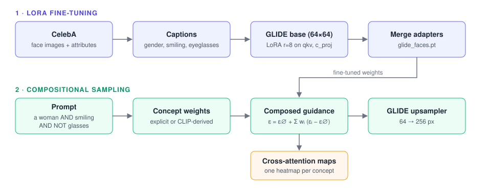

<p align="center">
  
</p>

<p align="center">
  <b>LoRA Fine-Tuning of OpenAI's GLIDE for Compositional Face Generation</b>
</p>

<p align="center">
  
  
  
  
</p>

Facet fine-tunes OpenAI's open-source [GLIDE](https://github.com/openai/glide-text2im) text-to-image diffusion model on CelebA with LoRA. The fine-tuned model is then used with composable diffusion ([Liu et al., 2022](https://arxiv.org/abs/2206.01714)) to generate faces from prompts that combine and negate attributes, such as **a woman AND smiling AND NOT glasses**. The project also adds cross-attention visualization and a classifier-based benchmark that checks whether each attribute in a prompt appears in the generated image.

## Overview

- **Parameter-efficient fine-tuning.** LoRA adapters (rank 8, α 16, dropout 0.1) are added to the attention projections (`qkv`, `c_proj`) of the pretrained 64×64 GLIDE base model and trained with the standard noise-prediction (MSE) objective, using fp16 mixed precision on CUDA. After training, the adapters are merged into a standalone checkpoint.
- **Captions from attributes.** CelebA's binary labels for gender, smiling and eyeglasses are turned into text captions such as *a woman smiling no glasses*, so the model learns to associate each attribute with its words.
- **Composed guidance.** A prompt is split on `AND` into concepts. Each concept gets a classifier-free guidance term, and the terms are summed with per-concept weights; `NOT` flips a concept's weight to steer away from it. GLIDE's upsampler then produces the 256×256 image.
- **Automatic concept weights.** Weights can be written explicitly (`smiling:9.5`). Otherwise they are derived from CLIP text embeddings, so concepts that overlap less with the rest of the prompt get more weight.
- **Explainability and evaluation.** GLIDE's attention layers are patched to record cross-attention during sampling, which is rendered as one heatmap per concept. A benchmark scores generated images with ResNet-18 attribute classifiers.
- **Apple Silicon.** A modified copy of GLIDE runs on MPS.

<p align="center">
  
</p>

<p align="center"><sub><b>Figure 1.</b> Fine-tuning GLIDE on CelebA (top) and sampling from the fine-tuned model with composed guidance (bottom).</sub></p>

<!--
## Results

| Model | Prompt | Smile ↑ | Glasses ↑ | Gender ↑ | All attributes ↑ |
|---|---|---|---|---|---|
| GLIDE (base) | | | | | |
| Facet (fine-tuned) | | | | | |
-->

## Quick start

Requires Python 3.9+ and a GPU (CUDA, or MPS on Apple Silicon). Trained weights are not distributed, so the first step is to fine-tune the model yourself.

```bash
# 1. Install
git clone https://github.com/denskrlv/compose-glide.git && cd compose-glide
python3 -m venv .venv && source .venv/bin/activate
pip install -e ./glide-text2im
pip install -e .

# 2. Fine-tune (downloads CelebA via kagglehub if --dataset is omitted)
python -m src.scripts.fine_tune --checkpoint_dir checkpoints --num_epochs 20

# 3. Put the merged checkpoint where Facet looks for it
mkdir -p models
cp checkpoints/glide_celeba_lora_finetuned_full.pt models/glide_faces.pt
```

```python
from compose_glide import ComposeGlide

compose_glide = ComposeGlide(model_name='glide_faces')

result, attention_data = compose_glide.generate(
    "a woman AND smiling AND NOT glasses",
    num_images=1,
    upsample=True,
    upsample_temp=0.995,
    return_attention_maps=True,
)

compose_glide.visualize_attention_maps(
    result[0], attention_data[0], "a woman AND smiling AND NOT glasses",
    output_path="attention.png", show_plot=False,
)
```

Use `model_name='base'` to run the same compositional sampling on the original, un-fine-tuned GLIDE.

## Fine-tuning

| Option | Default | Description |
|---|---|---|
| `--dataset` | download via kagglehub | CelebA root containing `list_attr_celeba.csv` and `img_align_celeba/img_align_celeba/` |
| `--checkpoint_dir` | `checkpoints` | Where adapters, optimizer state and the merged model are saved |
| `--num_epochs` | `20` | Number of training epochs |
| `--checkpoint_freq` | `5` | Save a checkpoint every N epochs (the best epoch is always saved) |
| `--checkpoint` | — | Resume from a saved checkpoint, e.g. `checkpoints/epoch_10` |

<details>
<summary><b>Checkpoints and outputs</b></summary>

<br/>

- **Adapters.** Each saved epoch writes the LoRA adapter weights and a `checkpoint.pt` with the optimizer state, epoch and best loss to `checkpoints/epoch_N/`. The lowest-loss epoch is also copied to `checkpoints/best/`.
- **Merged model.** When training finishes, the adapters are merged into the base weights and saved as `checkpoints/glide_celeba_lora_finetuned_full.pt`. This is a regular GLIDE state dict and needs no PEFT at inference time.
- **Loading.** `ComposeGlide(model_name='glide_faces')` loads `models/glide_faces.pt`. To use a different file, set `GLIDE_FACES_PATH=/path/to/checkpoint.pt`.

</details>

## Details

<details>
<summary><b>Installation options</b></summary>

<br/>

`./glide-text2im` is a copy of OpenAI's GLIDE modified to run on Apple Silicon (MPS). On CUDA you can use either this copy or the upstream package:

```bash
rm -rf glide-text2im
git clone https://github.com/openai/glide-text2im.git
pip install -e ./glide-text2im
pip install -e .
```

The fine-tuned model is loaded by Facet itself, so it works with both versions. Allow at least 32 GB of RAM.

</details>

<details>
<summary><b>Prompt syntax</b></summary>

<br/>

| Prompt | Meaning |
|---|---|
| `a woman AND smiling` | Two concepts, weights derived from CLIP |
| `a woman AND NOT glasses` | Steer towards *a woman* and away from *glasses* |
| `a woman:9.5 AND smiling:5` | Explicit guidance weight per concept |

Prompts are lowercased, so `AND`/`and` and `NOT`/`not` are equivalent. Concepts without an explicit weight default to 7.5 if CLIP weighting fails.

</details>

<details>
<summary><b>Model configuration</b></summary>

<br/>

| Component | Configuration |
|---|---|
| Base model | GLIDE base, 64×64, pretrained OpenAI checkpoint, cosine noise schedule, 1000 training timesteps |
| Adapters | LoRA r=8, α=16, dropout 0.1 on `qkv` and `c_proj`, no bias training |
| Data | CelebA resized to 64×64, batch size 100, attribute-derived captions |
| Objective | MSE between predicted and true noise at uniformly sampled timesteps |
| Optimisation | AdamW (lr 1e-4, β = 0.9, 0.999), fp16 autocast with gradient scaling on CUDA |
| Sampling | 100 respaced steps for the base model, 27 for the upsampler, upsample temperature 0.995 |

</details>

<details>
<summary><b>Evaluation</b></summary>

<br/>

`imagen.py` generates 20 images per prompt and `benchmark.py` scores them with three binary attribute classifiers (smiling, eyeglasses, male). It reports per-attribute accuracy and the share of images where every attribute matches the prompt.

```bash
python -m src.scripts.imagen --output_dir outputs/standard/1
python -m src.scripts.benchmark --output_dir outputs/standard/1 \
    --classifiers_dir models/binary_classifiers
```

The classifiers are ResNet-18 models exported to ONNX (`resnet18_smiling_model.onnx`, `resnet18_eyeglasses_model.onnx`, `resnet18_male_model.onnx`). They are not included in this repository, so place your own in `models/binary_classifiers/`.

</details>

<details>
<summary><b>Repository layout</b></summary>

<br/>

```
compose-glide/
├── glide-text2im/           # OpenAI's GLIDE, modified for MPS
├── images/                  # Banner and pipeline figure
├── notebooks/
│   └── demo.ipynb           # GLIDE vs Facet, base and fine-tuned
├── src/
│   ├── compose_glide/
│   │   ├── model.py         # Compositional sampling and attention capture
│   │   ├── utils.py         # Prompt parsing and CLIP-based weights
│   │   └── dataset/         # CelebA dataset and caption generation
│   └── scripts/
│       ├── fine_tune.py     # LoRA fine-tuning
│       ├── imagen.py        # Batch image generation
│       └── benchmark.py     # Attribute-classifier evaluation
└── pyproject.toml
```

</details>

## Acknowledgements

The compositional sampling follows the method and reference implementation of Liu et al., built on OpenAI's GLIDE.

- **[Compositional Visual Generation with Composable Diffusion Models](https://arxiv.org/abs/2206.01714)** — Liu, N., Li, S., Du, Y., Torralba, A., & Tenenbaum, J. B. (2022)
- **[GLIDE: Towards Photorealistic Image Generation and Editing with Text-Guided Diffusion Models](https://arxiv.org/abs/2112.10741)** — Nichol, A., Dhariwal, P., Ramesh, A., Shyam, P., Mishkin, P., McGrew, B., Sutskever, I., & Chen, M. (2022)
- **[LoRA: Low-Rank Adaptation of Large Language Models](https://arxiv.org/abs/2106.09685)** — Hu, E. J., Shen, Y., Wallis, P., Allen-Zhu, Z., Li, Y., Wang, S., Wang, L., & Chen, W. (2021)

## Citation

```bibtex
@software{krylov2025facet,
  author = {Denis Krylov},
  title  = {{Facet}: LoRA Fine-Tuning of OpenAI's GLIDE for Compositional Face Generation},
  year   = {2025},
  url    = {https://github.com/denskrlv/compose-glide}
}
```

## License

Released under the MIT License. The bundled `glide-text2im` is © OpenAI under its own [MIT License](glide-text2im/LICENSE).
